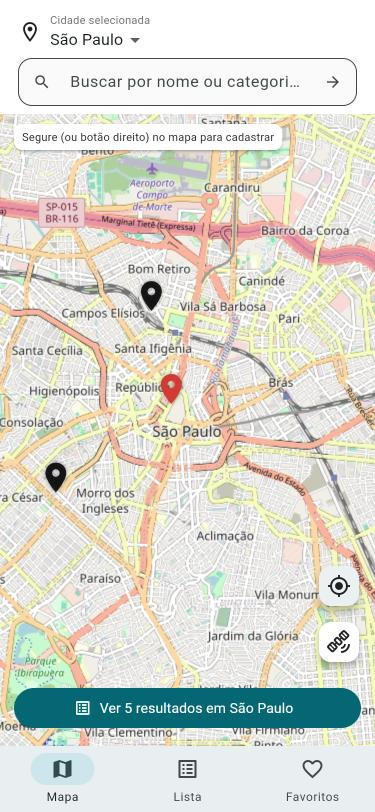

# Mapa de Locais — Flutter + Cloud Firestore

## 1. Problemática
Uma empresa quer um aplicativo para que usuários encontrem serviços e estabelecimentos em diferentes cidades: escolher a cidade, pesquisar, filtrar, ver detalhes e marcar favoritos. A equipe também precisa cadastrar, alterar e excluir locais.

## 2. Objetivo
Aplicativo Android em Flutter com três telas (Mapa, Resultados, Detalhes) cujos dados ficam no **Cloud Firestore**, com CRUD completo da coleção `locais`.

## 3. Requisitos funcionais
| Código | Requisito | Onde |
|---|---|---|
| RF01 | Selecionar cidade (São Paulo, Campinas, Jundiaí) | Mapa e Resultados |
| RF02 | Pesquisar por nome ou categoria | Mapa e Resultados |
| RF03 | Resultados vêm do Firestore (`snapshots()`) | Resultados, Detalhes, contador do Mapa |
| RF04 | Filtrar por categoria e cidade (+ "Somente favoritos") | Resultados |
| RF05 | Cadastrar local (`add`) | Botão "Cadastrar" → Bottom Sheet |
| RF06 | Editar local (`update`) | Menu ⋮ do card → Editar |
| RF07 | Excluir local com confirmação (`delete`) | Menu ⋮ do card → Excluir |
| RF08 | Exibir detalhes do local | Detalhes |
| RF09 | Favoritar (altera o campo `favorito`) | Coração na tela de Detalhes |
| RF10 | Navegar entre mapa, resultados e detalhes | Todas |

**Extras implementados (desafio nível 2 – mapa real):**
- Mapa real (OpenStreetMap via `flutter_map`): arrastar, zoom, marcadores vindos do Firestore (vermelho = favorito).
- Tocar no marcador mostra o card do local (abrir, editar, excluir).
- Segurar o dedo (ou botão direito no PC) no mapa cadastra um local naquele ponto.
- Trocar a cidade move o mapa; a busca filtra os marcadores enquanto digita.
- Botão de minha localização (GPS) e botão de camadas (mapa/satélite).
- Detalhes: mini-mapa, **Ligar** (abre o discador), **Como chegar** (rota no Google Maps), **Compartilhar** (copia os dados), editar/excluir e **Ver no mapa** (volta ao mapa centralizado no local).
- Abas: Mapa, Lista e Favoritos.

## 4. Requisitos não funcionais
- Flutter/Dart, Cloud Firestore, configurado com FlutterFire, roda em Android.
- Código organizado em pastas (`models`, `services`, `screens`, `widgets`, `dialogs`).
- Exclusão sempre pede confirmação.
- Toda operação no banco mostra mensagem de sucesso ou erro (SnackBar).
- Banco protegido por regras (`firestore.rules`) — não fica aberto.

## 5. Tecnologias
Flutter / Dart · Firebase · Cloud Firestore (`cloud_firestore`) · `firebase_core` · Firebase CLI · FlutterFire CLI · `flutter_map` + `latlong2` (mapa OpenStreetMap) · `geolocator` (GPS) · `url_launcher` (ligar e rotas).

## 6. Arquitetura
```
lib/
├── main.dart                  inicializa o Firebase (com cache offline) e prepara os dados
├── firebase_options.dart      gerado pelo `flutterfire configure` (não editar)
├── models/local.dart          classe Local + fromMap/toMap + centros das cidades
├── services/local_service.dart  único ponto que fala com o Firestore + filtro em memória
├── screens/
│   ├── mapa_screen.dart       tela 1: mapa real, cidade, pesquisa, marcadores, GPS, camadas
│   ├── resultados_screen.dart tela 2: lista, filtros, cadastrar/editar/excluir
│   └── detalhes_screen.dart   tela 3: mini-mapa, favorito, ligar, rota, compartilhar
├── widgets/
│   ├── local_card.dart        item da lista / card do marcador
│   └── local_form.dart        formulário de cadastro/edição (Bottom Sheet)
└── dialogs/
    ├── confirm_delete.dart    confirmação + exclusão
    └── feedback.dart          mensagens de sucesso/erro
```
As telas nunca acessam o Firestore diretamente: chamam o `LocalService`. As listas usam `StreamBuilder` sobre `snapshots()`, então qualquer alteração no banco aparece na hora, sem recarregar.

## 7. Modelo da coleção `locais`
| Campo | Tipo | Exemplo |
|---|---|---|
| nome | String | "Academia Fitness" |
| categoria | String | "Academia" |
| cidade | String | "São Paulo" |
| avaliacao | Number | 4.8 |
| distancia | Number | 1.2 |
| horario | String | "06:00 - 22:00" |
| descricao | String | "Academia completa..." |
| lat / lng | Number | -23.5614 / -46.6559 (posição no mapa) |
| telefone | String | "(11) 3251-0001" (opcional) |
| favorito | Boolean | false |

O ID do documento é gerado pelo Firestore. Na primeira execução, se a coleção estiver vazia, o app cadastra 10 locais de exemplo (`LocalService.popularSeVazio`).

## 8. Operações CRUD
| Operação | Firestore | Método no `LocalService` | Uso |
|---|---|---|---|
| Create | `locais.add()` | `adicionar(local)` | Cadastrar local |
| Read | `locais.snapshots()` / `doc(id).snapshots()` | `listarLocais()` / `observarLocal(id)` | Listar / detalhes |
| Update | `locais.doc(id).update()` | `atualizar(local)`, `alterarFavorito(id, valor)` | Editar / favoritar |
| Delete | `locais.doc(id).delete()` | `excluir(id)` | Excluir após confirmação |

## 9. Regras de segurança
`firestore.rules`: leitura liberada; criação/edição só com os 8 campos do modelo, tipos corretos, avaliação entre 0 e 5 e cidade válida; qualquer outra coleção bloqueada. Próximo passo (extensão): exigir `request.auth != null` para escrever.

Publicar: Firebase Console → Firestore → Regras → colar o conteúdo do arquivo → Publicar.

## 10. Como executar
```bash
npm install -g firebase-tools
firebase login
dart pub global activate flutterfire_cli
flutterfire configure        # projeto mapa-locais-92725, plataformas Android, Web e Windows
cd mapa
flutter pub get
flutter run -d chrome --release
flutter test                 # testes automatizados de model e filtros
```
No VS Code: aba **Executar e Depurar** → "Mapa de Locais (Chrome, rápido)" → F5.

Para rodar em Android é preciso o Android Studio (SDK/emulador); para rodar como app do Windows é preciso o Visual Studio com "Desenvolvimento para desktop com C++".
No Windows, ative o **Modo de Desenvolvedor** (necessário para plugins).

## 11. Tabela de testes
| ID | Teste | Procedimento | Resultado |
|---|---|---|---|
| T01 | Conexão | Abrir o app e ver os dados do Firestore | Passou — 10 locais carregados do Firestore |
| T02 | Pesquisa | Pesquisar "Academia" | Passou (teste automatizado: 5 resultados) |
| T03 | Cidade | Selecionar Campinas | Passou (teste automatizado) |
| T04 | Filtro | Selecionar uma categoria | Passou (teste automatizado) |
| T05 | Create | Cadastrar local e conferir no Firestore | Passou — "Local cadastrado!", lista foi de 5 para 6 |
| T06 | Read | Fechar/reabrir a tela e ver o registro | Passou — dados continuam após recarregar o app |
| T07 | Update | Editar nome ou horário e confirmar | Passou — horário alterado para 09:00 - 18:00 e visto nos detalhes |
| T08 | Delete | Excluir local e confirmar que sumiu | Passou — confirmação exibida, "Local excluído com sucesso.", lista voltou a 5 |
| T09 | Favorito | Marcar e desmarcar um local | Passou — coração marcado e desmarcado, com mensagem |
| T10 | Navegação | Abrir resultados e detalhes e voltar | Passou — Mapa → Resultados → Detalhes → "Ver no mapa" volta ao mapa |
| T11 | Erro | Desligar a internet / regra bloqueando e ver a mensagem | Não testado |

T02, T03 e T04 também são cobertos por `flutter test` (`test/widget_test.dart`).

## 12. Capturas
Testes feitos na versão Web (Chrome, tela de celular 375×812), projeto Firebase `mapa-locais-92725`, banco em `southamerica-east1`.

| Mapa | Resultados | Detalhes |
|---|---|---|
|  |  |  |

_Print do Firestore: adicionar `docs/prints/4-firestore.png` (Console → Firestore → coleção `locais`)._

## 13. Conclusão
A primeira versão do app guardava os locais numa lista em memória: tudo funcionava, mas os dados sumiam ao fechar o app. A migração para o Cloud Firestore exigiu pouca mudança nas telas, porque o acesso a dados já estava isolado no `LocalService`: bastou trocar a lista por chamadas `add`, `update`, `delete` e `snapshots()` e envolver as listas em `StreamBuilder`. Com isso, qualquer alteração (inclusive feita direto no Console) aparece na hora em todas as telas.

As principais dificuldades foram a configuração do ambiente (Firebase CLI, FlutterFire CLI, login e Modo de Desenvolvedor do Windows) e o tratamento de erros: como as operações de banco podem falhar por rede ou por regra de segurança, cada uma passou a mostrar uma mensagem de sucesso ou erro. As regras do Firestore validam os campos do modelo, o que impede gravar dados inválidos mesmo fora do app.

Melhorias futuras: autenticação para restringir escrita a administradores, favoritos por usuário, mapa real (Google Maps) e filtros direto no Firestore com `where`/`orderBy`.
